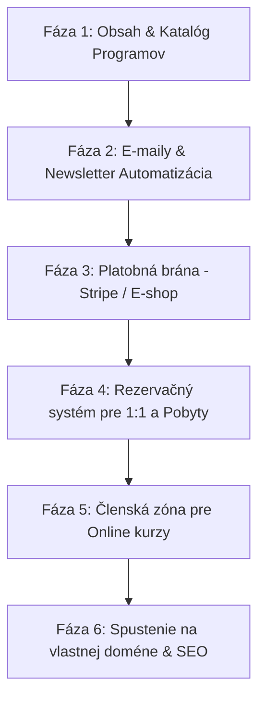

# 🗺️ IMPLEMENTAČNÝ PLÁN: ZUZANA METAMORPHOSIS

Tento dokument slúži ako kompletný technický a strategický manuál pre rozvoj, integrácie a automatizácie webovej platformy **Zuzana Metamorphosis**.

---

## 📌 1. Prehľad architektúry projektu

- **Frontend & Backend:** Next.js 16 (App Router), React 19, TypeScript
- **Dizajn & Štýly:** TailwindCSS v4, Lucide ikony, moderný luxusný glassmorphism štýl
- **Jazyky:** Bilingválna podpora (Slovenčina 🇸🇰 a Nemčina 🇩🇪)
- **Hosting & Infraštruktúra:** Vercel (s bleskovým CDN po celej Európe)

---

## 🚀 2. Fázy implementácie

---

## 📝 FÁZA 1: Obsah a prezentácia (Aktuálny stav - HOTOVO)

### Čo je pripravené:
1. **Blog & Journal:**
   - Články s prepínačom **SK / DE** (Ranný rituál Tvorcu, Metamorfóza, Sila jednoduchosti, Príbehy z Paríža a mora).
   - Štruktúrovaná typografia, citácie, kroky rituálov.
2. **Katalóg na `/shop`:**
   - 7 programov a produktov (E-book, pobyt Grécko, pobyt Slovensko, EL-Metóda varianty A/B, Kostrčovo-panvové dýchanie, Smile Yoga Viedeň, 1:1 Diagnostika).
   - Filtrovanie podľa kategórií, detailné karty s rozpisom benefitov.

---

## ✉️ FÁZA 2: E-mailový systém a marketingová automatizácia

Cieľ: Zber kontaktov, okamžité doručovanie PDF e-bookov a automatické posielanie článkov/rituálov v čase (Nurturing sekvencia).

### Odporúčané nástroje:
1. **Resend (Transakčné maily z Next.js):**
   - Okamžité doručenie potvrdenia objednávky, odkazu na stiahnutie E-booku a notifikácií o nových dopytoch priamo do mailu Zuzany.
2. **Ecomail / ConvertKit / Mailchimp (E-mail marketing):**
   - Správa kontaktov v súlade s GDPR.
   - Vytvorenie automatickej kampane:
     - **Deň 0:** Uvítací email + E-book / zhrnutie 7 krokov rituálu.
     - **Deň 3:** Článok o neuroplasticite a 60-sekundovom úsmeve.
     - **Deň 7:** Predstavenie 7-dňového pobytu Metamorphosis v Grécku.

### Čo je potrebné pripraviť:
- [ ] Vlastná e-mailová adresa na doméne (napr. `zuzana@metamorphosis.sk` alebo `info@...`).
- [ ] Nastavenie DNS záznamov (SPF, DKIM, DMARC) pre 100% doručiteľnosť bez padania do spamu.
- [ ] Formulár na webe: „Prihlásiť sa na odber rituálov & inšpirácií“.

---

## 💳 FÁZA 3: Platobná brána (Predaj E-booku, kurzov a záloh)

Cieľ: Plne automatizovaný predaj 24/7 bez nutnosti manuálneho posielania faktúr a čakania na bankové prevody.

### Odporúčané riešenie: **Stripe**
- **Podporované platby:** Platobné karty (Visa, Mastercard), **Apple Pay**, **Google Pay**, SEPA platby.
- **Pre CZ/SK trh:** Možnosť pridať **GoPay** / **Comgate** (pre okamžité bankové tlačidlá).

### Ako bude prebiehať nákup:
1. Zákazník klikne na *„Kúpiť E-book“* alebo *„Objednať kurz EL-Metóda (Variant VIP)“*.
2. Otvorí sa bezpečná pokladňa (Stripe Checkout) s voľbou platby cez Apple Pay / kartu.
3. Po úspešnej platbe Stripe pošle zabezpečený Webhook na náš Next.js server.
4. Systém automaticky:
   - Vygeneruje a odošle faktúru / doklad o zaplatení.
   - Zašle zákazníkovi email s odkazom na stiahnutie PDF alebo prístupovými údajmi do kurzu.
   - Pridá zákazníka do databázy nakupujúcich.

### Čo je potrebné pripraviť:
- [ ] Založenie účtu na [Stripe.com](https://stripe.com) (alebo GoPay) a overenie firemných/živnostenských údajov.
- [ ] Prepojenie API kľúčov (`STRIPE_SECRET_KEY`, `STRIPE_WEBHOOK_SECRET`).

---

## 📅 FÁZA 4: Rezervačný systém (Termíny pre 1:1 a Pobyty)

Cieľ: Odstrániť zdĺhavé dohadovanie termínov cez správy. Klient si sám vyberie voľný termín v kalendári.

### Odporúčané riešenie: **Cal.com** alebo **Calendly**
- **Prepojenie:** Priama synchronizácia s osobným Google Kalendárom / Apple Kalendárom Zuzany.
- **Automatická detekcia voľna:** Zobrazujú sa iba časy, kedy Zuzana nemá v kalendári inú udalosť.
- **Funkcie:**
  - Výber typu stretnutia (napr. *1:1 Osobná diagnostika 60 min*, *Smile Yoga Viedeň*, *Konzultácia k pobytu v Grécku*).
  - Možnosť podmieniť rezerváciu platbou (napr. záloha za termín cez Stripe).
  - Automatické generovanie odkazu na Google Meet / Zoom pri online stretnutiach.
  - Automatické pripomienky 24h a 1h pred stretnutím.

---

## 🔐 FÁZA 5: Členská zóna pre Online kurzy (EL-Metóda, Dýchanie)

Cieľ: Profesionálne prostredie, kde študenti nájdu videolekcie, texty a materiály rozdelené do modulov.

### Štruktúra zóny:
- **Prihlásenie:** E-mail + heslo / Jednorazový magický odkaz do mailu (bezpečné a jednoduché bez zabudnutých hesiel).
- **Video prehrávač:** Rýchle a bezpečné prehrávanie bez možnosti neoprávneného sťahovania.
- **Moduly kurzu:**
  - *EL-Metóda:* 5 modulov po 45 minútach + teoretické podklady a cvičenia.
  - *Kostrčovo-panvové dýchanie:* 3 ucelené praktické video moduly.
  - *VIP zóna:* Rezervácia 1. a 2. osobnej konzultácie priamo z klientskeho profilu.

---

## 🌐 FÁZA 6: Nasadenie do produkcie, Doména & SEO

### Kroky k spusteniu:
1. **Doména a DNS:**
   - Napojenie vlastnej domény (napr. `zuzanametamorphosis.com` alebo `metamorphosis.sk`) na Vercel hosting.
   - Automatické vygenerovanie bezpečnostného SSL certifikátu (HTTPS).
2. **SEO & Sociálne siete:**
   - OpenGraph náhľady (pekný obrázok a popis pri zdieľaní odkazu na Instagrame, Facebooku či WhatsAppe).
   - Štruktúrované dáta pre Google vyhľadávač.
3. **Analytika:**
   - Napojenie Google Analytics 4 alebo Plausible (meranie návštevnosti, odkiaľ ľudia prichádzajú).
   - Meta Pixel (pre prípadné reklamy na Instagrame/Facebooku).

---

## 📋 Zoznam požiadaviek pre spustenie jednotlivých častí (Pre Zuzanu / Tím)

| Modul | Čo je potrebné dodať / založiť | Kedy |
|---|---|---|
| **E-book** | Finálny PDF súbor e-booku, predajná cena v EUR | Pred spustením platieb |
| **Pobyty** | Presné termíny konania, kapacita a cenové podmienky | Pred spustením rezervácií |
| **Platobná brána** | Registrácia na Stripe.com (bankový účet, IČO/DIČ) | Pred spustením e-shopu |
| **Kalendár** | Prepojenie na Google / Apple kalendár pre voľné časy | Pred spustením 1:1 rezervácií |
| **Videá ku kurzom** | Nahrané video lekcie pre 5 modulov EL-Metódy a Dýchania | Pred spustením členskej zóny |

---

*Tento implementačný plán je uložený priamo v projekte v súbore [IMPLEMENTACNY_PLAN.md](file:///c:/Users/drmar/Downloads/zuzana-metamorphosis/IMPLEMENTACNY_PLAN.md).*
